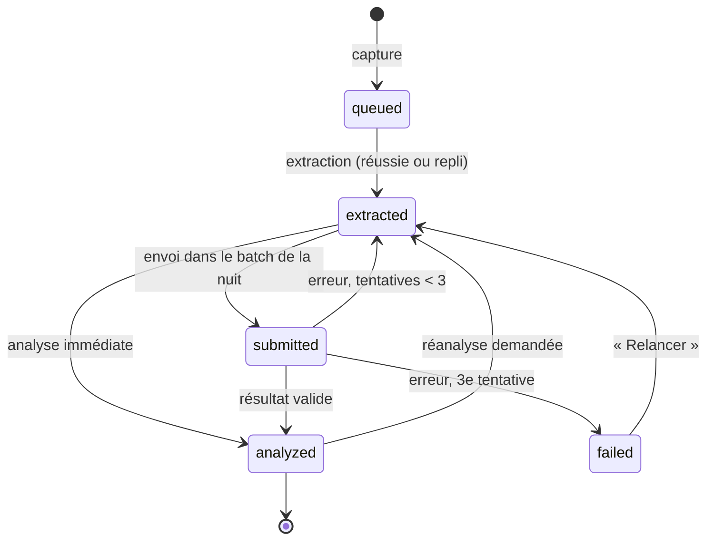
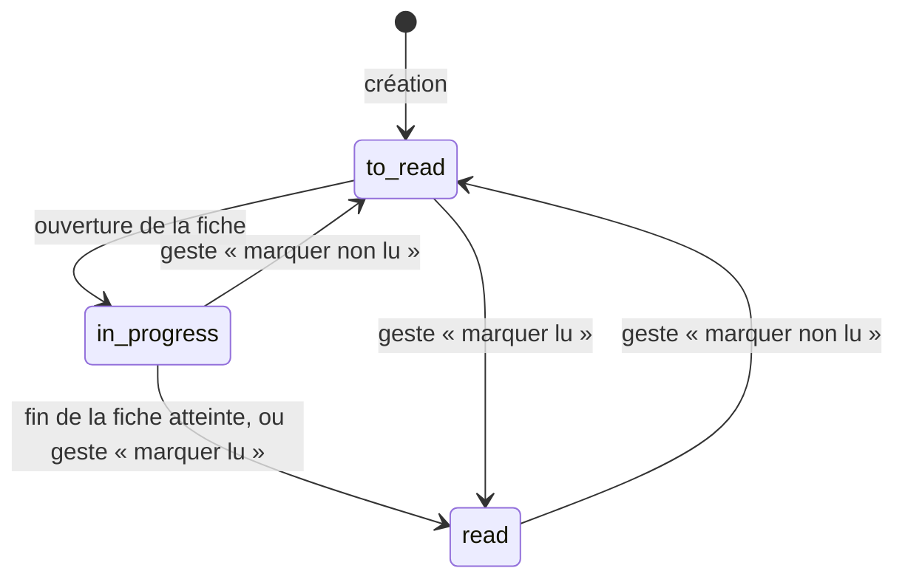

# Hippo — Document métier

Ce document décrit **ce que fait Hippo et selon quelles règles**, indépendamment de la technique. Il fait foi pour le comportement attendu : si le code et ce document divergent, l'un des deux est faux, et on tranche ici.

- Les termes en **gras** sont définis dans le [glossaire](glossary.md). On n'emploie pas de synonyme.
- Les règles sont numérotées (`RG-xx`) pour être citées dans la [backlog](backlog.md), les tests et les revues de code. Un numéro n'est jamais réutilisé ; une règle supprimée est barrée, pas renumérotée.
- Le *comment* technique est dans la [spec V1](spec-v1.md) et les [ADR](adr/README.md).

## 1. Vision

### Le problème

Ghislain croise chaque jour des choses qu'il veut retenir : un article sur une nouveauté de Java, un reel Instagram avec une astuce ménage, un resto à tester à Lille, un outil d'IA à essayer. Elles sont éparpillées entre Safari, Instagram, des newsletters et des captures d'écran, et finissent oubliées. Les newsletters par mail ne sont pas lues. Les gestionnaires de favoris stockent sans ranger ni résumer.

### La réponse

Hippo est un **deuxième cerveau** personnel :

1. **Capturer en un geste**, depuis n'importe quelle appli de l'iPhone.
2. **Laisser l'IA ranger et résumer pendant la nuit**, dans une forme adaptée à chaque contenu.
3. **Retrouver en quelques secondes**, et lire confortablement, même hors ligne.
4. *(V2)* **Se tenir au courant** grâce à un digest du matin construit à partir des sujets suivis.

Le nom vient de l'hippocampe, la zone du cerveau qui enregistre les souvenirs de la journée et les consolide, en grande partie pendant le sommeil. C'est exactement le rythme de l'appli : on capture le jour, Hippo range la nuit.

### Principes directeurs

Ces principes servent à trancher quand une règle ne couvre pas un cas.

| Principe | Ce que ça veut dire concrètement |
| --- | --- |
| **Ne rien perdre** | Sur le contenu technique, une information utile manquante est un bug. Le contenu original est conservé pour pouvoir réanalyser. |
| **L'IA propose, l'utilisateur dispose** | L'IA range et peut proposer du nouveau, mais ne modifie ni ne supprime jamais ce que l'utilisateur a créé ou corrigé. |
| **Zéro friction à la capture** | Capturer prend moins de 5 secondes et ne demande aucune décision. Tout le reste peut attendre. |
| **Rien de bloquant** | Sauter la revue, ne pas lire le digest, être hors ligne : l'appli continue de fonctionner. |
| **Pas de remplissage** | Aucun quota de contenu. Une fiche courte pour un contenu court, un digest vide un jour calme. |
| **Coût maîtrisé** | Chaque appel à l'IA a un coût prévisible, plafonné, et visible. |
| **Données chez soi** | Les données vivent sur le NAS de l'utilisateur, sont exportables à tout moment dans un format ouvert. |

## 2. Utilisateur et usages

**Un seul utilisateur en V1** : Ghislain, développeur back-end depuis 5 ans, curieux de beaucoup de domaines. L'appli n'est pas un outil de dev : elle couvre toute sa vie (dev, IA, infra et DevOps, actualité, maison, cuisine, plantes, jeux vidéo, voyages et sorties).

### Scénarios clés de la V1

1. **Capturer au vol.** Dans Instagram, Ghislain voit un reel avec une astuce pour détartrer une douche. Partager → Hippo → (note facultative) → Enregistrer. Trois secondes, il revient à Instagram.
2. **Capturer une capture d'écran.** Il fait une capture d'une recette affichée dans une story. Partager → Hippo. La nuit, l'IA lit l'image et en fait une fiche recette.
3. **Noter une idée.** Dans l'appli, écran Capture, il dicte avec le clavier iOS une idée entendue en réunion.
4. **La revue du matin.** Au café, il ouvre l'écran Revue : 6 éléments rangés pendant la nuit, dont un dans une catégorie proposée « Infra › Kubernetes ». Il accepte la catégorie, corrige un tag, c'est fini.
5. **Retrouver.** Trois semaines plus tard, il cherche « détartrer » : la fiche astuce apparaît, avec ses étapes.
6. **Lire.** Il ouvre un article technique sauvegardé, lit la moitié dans le métro sans réseau, et reprend le soir au même endroit.

## 3. Périmètre

| Version | Contenu |
| --- | --- |
| **V1 — Capture** | Capture de liens, images et notes ; extraction ; analyse de nuit ; 7 types de contenu ; catégories et types proposés ; revue ; lecture avec position ; recherche plein texte ; hors ligne ; export Markdown. |
| **V1.5 — Recherche** | Recherche sémantique, éléments liés, extraction des reels Instagram, découpage des contenus très longs, mémo vocal transcrit. |
| **V2 — Veille** | Sujets suivis, sources, digest du matin, actualité générale, importance, regroupement, surlignage. |
| **V3 — Boucle** | Avis de pertinence, questions de révision, badge « peut-être obsolète », serveur MCP. |
| **Plus tard** | Questions posées à la base, suggestions de sujets, radar techno, widget iOS. |

Le détail par fonctionnalité est dans la [spec V1](spec-v1.md#périmètre).

### Non-objectifs

- **Pas un lecteur RSS** : la V2 trie et résume, elle ne montre pas tout ce qui sort.
- **Pas un outil de prise de notes** : pas d'éditeur riche, pas de liens entre notes à la main. Une note est une capture comme une autre.
- **Pas de collaboration** : pas de partage, pas de multi-utilisateur en V1 (mais le modèle de données le prépare, voir RG-90).
- **Pas de lecture de vidéos dans l'appli** : on ouvre l'original.

## 4. Cycle de vie d'un élément

Un élément a deux statuts **indépendants** : son **statut de traitement** (où il en est dans le pipeline) et son **statut de lecture** (où en est l'utilisateur).

### Statut de traitement

- Un **élément privé** s'arrête à `extracted` : il n'est jamais soumis à l'IA (RG-12).
- Une **fiche incomplète** reste `analyzed` mais est remise dans la file une seule fois (RG-36).

### Statut de lecture

## 5. Règles métier

### Capture

- **RG-01** — Une capture crée un élément de forme `link`, `image` ou `note`. Elle est acceptée et confirmée immédiatement ; aucune analyse n'a lieu pendant la capture.
- **RG-02** — Une capture `link` doit contenir une URL `http` ou `https` valide. Une capture `note` doit contenir un texte non vide. Une capture `image` doit contenir une image d'un format courant (JPEG, PNG, HEIC, WebP) de 20 Mo maximum.
- **RG-03** — Une **note de capture** est facultative pour toutes les formes. Elle est transmise à l'IA comme indice d'intention.
- **RG-04** — **Doublons.** Si l'**URL normalisée** d'une capture correspond à un élément existant du même utilisateur, aucun nouvel élément n'est créé : l'élément existant est renvoyé. Si la nouvelle capture porte une note, celle-ci est ajoutée à la suite de la note existante, datée. Les images et les notes ne sont jamais considérées comme des doublons.
- **RG-05** — **Normalisation d'URL** : schéma et hôte en minuscules, fragment (`#…`) retiré, paramètres de tracking retirés (`utm_*`, `fbclid`, `gclid`, `igsh`, `si`, `ref`), slash final retiré, paramètres restants triés. L'URL d'origine est conservée telle quelle pour l'ouverture.
- **RG-06** — Une capture faite **hors ligne** depuis l'appli est mise en attente sur le téléphone et envoyée automatiquement au retour du réseau. Depuis l'extension de partage, une capture hors ligne échoue avec un message clair et la possibilité de copier le lien.

### Élément privé

- **RG-10** — L'option **Privé** est proposée à chaque capture, **décochée par défaut**.
- **RG-11** — Un élément privé est stocké, cherchable et lisible comme les autres.
- **RG-12** — Un élément privé n'est **jamais** envoyé à l'IA : ni dans le batch, ni en analyse immédiate. Aucune exception, y compris en cas d'erreur de configuration.
- **RG-13** — Un élément privé n'a pas de fiche générée. Il apparaît dans **À trier** jusqu'à ce que l'utilisateur lui donne une catégorie.
- **RG-14** — Décocher « Privé » sur un élément existant le remet dans la file d'analyse. Cocher « Privé » sur un élément déjà analysé conserve sa fiche mais empêche toute réanalyse.

### Extraction

- **RG-20** — L'extraction a lieu juste après la capture, en arrière-plan, sans appel à l'IA.
- **RG-21** — Pour une page web, on extrait le titre, le nom du site et le contenu principal (sans menus, publicités ni commentaires).
- **RG-22** — Pour une vidéo YouTube, on récupère le titre, la chaîne, la durée et la transcription quand elle existe.
- **RG-23** — **Repli.** Si l'extraction échoue (paywall, page qui exige JavaScript, Instagram, délai dépassé de 15 s), on conserve ce qu'on peut obtenir (`og:title`, `og:description`, image d'aperçu) et la note de capture. L'élément part quand même en analyse : il n'existe pas d'échec d'extraction bloquant.
- **RG-24** — Le **contenu extrait** est conservé jusqu'à environ 120 000 caractères. Au-delà, il est coupé et l'élément est marqué **contenu tronqué** ; la fiche l'indique.
- **RG-25** — Le **temps de lecture** de l'original est calculé à l'extraction (environ 230 mots par minute pour un texte, la durée pour une vidéo), pas par l'IA.

### Analyse

- **RG-30** — Les éléments en attente sont analysés **une fois par nuit**, en un seul batch (2 h par défaut). Un élément capturé dans la journée est analysé au plus tard le lendemain matin, sauf budget atteint (RG-81).
- **RG-31** — S'il n'y a rien à analyser, aucun appel n'est fait.
- **RG-32** — Un batch contient au maximum 200 éléments. Le surplus attend la nuit suivante, les plus anciens en premier.
- **RG-33** — L'**analyse immédiate** d'un élément est possible à la demande, au plein tarif. Elle respecte RG-12 et RG-81.
- **RG-34** — L'analyse produit, pour chaque élément : un type de contenu, une catégorie, 2 à 5 tags, un titre, une fiche au format du type, la langue de l'original, la fraîcheur, et un indicateur de contenu pauvre.
- **RG-35** — Une réponse de l'IA qui ne respecte pas le schéma attendu est rejetée entièrement : rien n'est écrit, l'élément compte une tentative. Après 3 tentatives, il passe en `failed` et apparaît dans À trier et dans Réglages avec un bouton « Relancer ».
- **RG-36** — **Fiche incomplète.** Si l'IA atteint son plafond de sortie, la fiche est enregistrée, marquée incomplète, et l'élément est réanalysé **une seule fois** la nuit suivante avec un plafond doublé. Si elle reste incomplète, elle est gardée telle quelle avec la mention visible.
- **RG-37** — **Contenu pauvre.** Quand l'IA signale un contenu insuffisant, la fiche contient seulement ce qui est connu ; l'appli affiche « contenu partiel » et propose d'ouvrir l'original. L'IA ne doit **jamais inventer** d'information pour compléter.

### Fiche

- **RG-40** — La fiche est rédigée **en français**, dans un style simple, comme à un collègue. Les termes techniques, noms d'API, commandes et extraits de code restent **en anglais et tels quels**.
- **RG-41** — **Fidélité technique.** Pour un contenu technique, aucune information utile ne doit être perdue : versions, chiffres, commandes, options, extraits de code, limites et pièges sont recopiés à l'identique. La concision ne justifie jamais une perte d'information.
- **RG-42** — **Longueur proportionnelle.** La longueur de la fiche suit la richesse du contenu : quelques lignes pour une astuce, plusieurs sections pour un article technique dense. Pas de remplissage.
- **RG-43** — La structure de la fiche dépend du type de contenu (voir section 7).
- **RG-44** — La fiche n'est **pas éditable** par l'utilisateur. Pour ajouter quelque chose, il utilise les annotations ; pour la refaire, la réanalyse.
- **RG-45** — L'original reste toujours accessible en un geste depuis la fiche (lien, image ou texte de la note).

### Classement

- **RG-50** — Chaque élément a **une seule catégorie**, celle de son sujet principal. Ce qui est transversal passe par les tags.
- **RG-51** — L'arborescence des catégories a **2 niveaux maximum** (catégorie racine, sous-catégorie). *Point ouvert : un 3e niveau pourra être envisagé si le classement le demande.*
- **RG-52** — L'IA reçoit l'arborescence complète (catégories actives **et** proposées, avec leurs descriptions), la liste des types et les tags existants. Elle range **en priorité dans l'existant**.
- **RG-53** — Si aucune catégorie ne convient, l'IA **propose** une nouvelle catégorie, avec un nom, un parent éventuel, une description et une justification d'une ligne. La catégorie est créée avec le statut `proposed` et l'élément y est rangé immédiatement.
- **RG-54** — Avant de créer une proposition, le backend vérifie qu'aucune catégorie (active ou proposée) n'a déjà le même nom normalisé sous le même parent ; si c'est le cas, il réutilise l'existante.
- **RG-55** — Une proposition dont le parent est invalide (inexistant, ou déjà sous-catégorie) est rattachée au parent valide le plus proche, à défaut à la racine. Une proposition n'est jamais rejetée pour ce motif.
- **RG-56** — **L'IA ne peut jamais** renommer, déplacer, fusionner ni supprimer une catégorie, un type ou un tag existant. Toute évolution de l'existant passe par l'utilisateur.
- **RG-57** — Même logique pour les **types de contenu** : l'IA choisit parmi les types existants ou en propose un nouveau (`proposed`). Un type proposé s'affiche avec le template générique tant qu'il n'a pas de template dédié.
- **RG-58** — **Tags** : 2 à 5 par élément, réutilisés en priorité. Le backend normalise tout tag reçu (minuscules, sans accent, espaces et `_` remplacés par des tirets, 40 caractères maximum) et ignore les doublons.
- **RG-59** — Une sous-catégorie hérite de la couleur de sa catégorie racine, sauf couleur définie explicitement.

### Corrections et réanalyse

- **RG-60** — L'utilisateur peut à tout moment changer le type, la catégorie et les tags d'un élément. Chaque champ modifié est enregistré comme **correction manuelle**.
- **RG-61** — Une réanalyse **ne modifie jamais** un champ corrigé à la main, ni les annotations, la note de capture, l'épingle ou le statut de lecture.
- **RG-62** — Une réanalyse remplace la fiche et remet la position de lecture à zéro (le contenu a changé), sans changer le statut de lecture.
- **RG-63** — La réanalyse se fait à partir du contenu extrait conservé ; on ne retélécharge pas l'original.
- **RG-64** — Chaque fiche enregistre le modèle, la version du prompt et la version du schéma qui l'ont produite, pour pouvoir réanalyser de façon ciblée.

### Revue

- **RG-70** — La revue présente les éléments analysés depuis la dernière revue, avec leur type, leur catégorie et leurs tags, et met en évidence les catégories et types **proposés**.
- **RG-71** — Par défaut, tout est considéré comme correct : l'utilisateur n'agit que sur ce qui est faux. Terminer la revue enregistre sa date.
- **RG-72** — Une proposition peut être **acceptée** (elle devient active), **renommée** (et acceptée), ou **fusionnée** dans une catégorie ou un type existant (ses éléments y sont déplacés, la proposition disparaît). Fusionner un type proposé dans un type existant remet ses éléments en file d'analyse, puisque leur fiche est au format générique.
- **RG-73** — La revue n'est jamais bloquante. Les propositions non traitées restent utilisables et réapparaissent à la revue suivante.
- **RG-74** — L'utilisateur peut aussi fusionner deux catégories actives, ou deux tags, en dehors de la revue.

### Lecture et organisation

- **RG-75** — Ouvrir une fiche « À lire » la passe « En cours ». Atteindre la fin de la fiche (95 % du défilement) la passe « Lu ». L'utilisateur peut forcer « Lu » ou « Non lu » d'un geste.
- **RG-76** — La position de lecture est enregistrée à la fermeture de la fiche et toutes les quelques secondes pendant la lecture. Rouvrir une fiche « En cours » propose de reprendre à cette position.
- **RG-77** — L'**épingle** marque un élément « à ne pas oublier ». Un élément épinglé apparaît en tête de sa catégorie et dans le filtre « Épinglés ».
- **RG-78** — Les **annotations** sont du texte libre, modifiable à tout moment, inclus dans la recherche et dans l'export.
- **RG-79** — La suppression d'un élément est définitive (fiche, contenu extrait, images) après confirmation.

### Coûts

- **RG-80** — Chaque batch enregistre les tokens consommés et son coût calculé.
- **RG-81** — **Budget mensuel.** Si le coût cumulé du mois atteint le budget (5 $ par défaut), plus aucune analyse n'est lancée jusqu'au 1er du mois suivant, ni batch ni analyse immédiate. Réglages affiche une alerte ; les éléments restent en file.
- **RG-82** — Le coût du mois en cours est visible dans Réglages.

### Données et multi-utilisateur

- **RG-90** — Toute donnée métier appartient à un utilisateur (`user_id`). En V1, il n'y en a qu'un, mais aucune requête ne doit lire ou écrire sans filtrer par utilisateur.
- **RG-91** — L'**export** produit un fichier Markdown par élément, rangé par catégorie, avec en en-tête (front matter) le titre, l'URL, le type, la catégorie, les tags et les dates ; puis la fiche, puis les annotations. Les images sont incluses. Le Markdown est généré à la demande, jamais stocké.
- **RG-92** — Les données ne sortent du NAS que vers l'IA (pour les éléments non privés) et vers la sauvegarde externe chiffrée.

### Recherche

- **RG-95** — La recherche plein texte porte sur le titre, la fiche, la note de capture, les annotations et les tags. Elle ignore la casse et les accents.
- **RG-96** — Les filtres (type, catégorie, tag, statut de lecture, épinglés, À trier) se combinent entre eux et avec la recherche.
- **RG-97** — La recherche et la lecture fonctionnent hors ligne sur les éléments déjà synchronisés.

## 6. Catégories de départ

Proposition pour amorcer l'arborescence. Elle est modifiable à tout moment et l'IA la complétera par des propositions.

| Catégorie | Sous-catégories de départ | Description donnée à l'IA |
| --- | --- | --- |
| Dev | Java & Spring, Bases de données, Front & mobile, Architecture & pratiques | Développement logiciel : langages, frameworks, bases de données, conception, tests. |
| IA | Outils & agents, Modèles, Usages au quotidien | Intelligence artificielle, en particulier appliquée au développement. |
| Infra & DevOps | Conteneurs & orchestration, CI/CD, Cloud, Auto-hébergement | Infrastructure, déploiement, exploitation, réseau, NAS. |
| Actu tech | — | Actualités et annonces du monde de la tech qui ne relèvent pas d'un domaine précis. |
| Maison & quotidien | Ménage, Bricolage, Astuces pratiques | Entretien de la maison, astuces de la vie de tous les jours. |
| Cuisine | — | Recettes, techniques et astuces de cuisine. |
| Plantes | — | Entretien des plantes d'intérieur et d'extérieur. |
| Jeux vidéo | — | Jeux, matériel, émulation. |
| Voyages & sorties | Lille | Lieux à visiter, restaurants, sorties, voyages. |

## 7. Types de contenu

| Type | Clé | Quand l'utiliser | Contenu de la fiche |
| --- | --- | --- | --- |
| Article technique | `tech_article` | Article, annonce, notes de version, billet de blog technique | TL;DR en quelques lignes, ce qui change, détails techniques (versions, chiffres, commandes, code), limites et pièges, liens utiles |
| Tuto | `tutorial` | Marche à suivre pour obtenir un résultat | Objectif, prérequis, étapes numérotées (avec commandes ou code), résultat attendu, dépannage |
| Astuce | `tip` | Conseil court et pratique | L'astuce en une phrase, étapes courtes, matériel, précautions |
| Recette | `recipe` | Recette de cuisine | Portions, temps, ingrédients avec quantités, étapes, conseils |
| Lieu | `place` | Endroit à visiter : resto, bar, musée, balade, ville | Nom, ville, adresse, ce qu'on y fait, infos pratiques connues, meilleur moment |
| Ressource | `resource` | Outil, librairie, repo, site, service à retenir | Ce que c'est, à quoi ça sert, quand l'utiliser, lien, alternatives citées |
| Note perso | `note` | Idée, chose entendue, réflexion personnelle | L'idée reformulée proprement, points clés, pistes à creuser |
| Générique | `generic` | Type proposé par l'IA, en attendant un template dédié | Résumé, sections libres, points clés |

Le schéma exact de chaque fiche est dans [`prompt/schemas/`](prompt/schemas/).

## 8. Décisions déjà prises pour la V2

Rappel des règles fixées dès maintenant, pour que la V1 ne les contredise pas. Détail dans la [spec V1](spec-v1.md#v2--décisions-déjà-prises).

- Les articles de veille passent par **le même pipeline** que les captures (source `rss`).
- Le digest n'a **pas de quota** : seuil de pertinence, 30 minutes comme repère seulement.
- Un même sujet occupe **2 places au maximum** dans un digest ; un groupe d'articles sur le même événement compte pour un.
- Le contenu des articles non sauvegardés est **supprimé après 30 jours** ; seule une trace légère reste.
- L'importance (4 niveaux) ne s'applique qu'aux actualités ; aucune alerte en temps réel.
